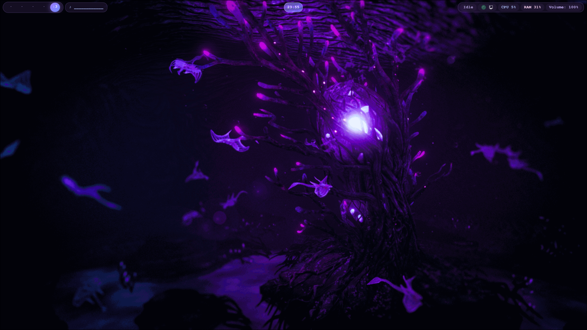
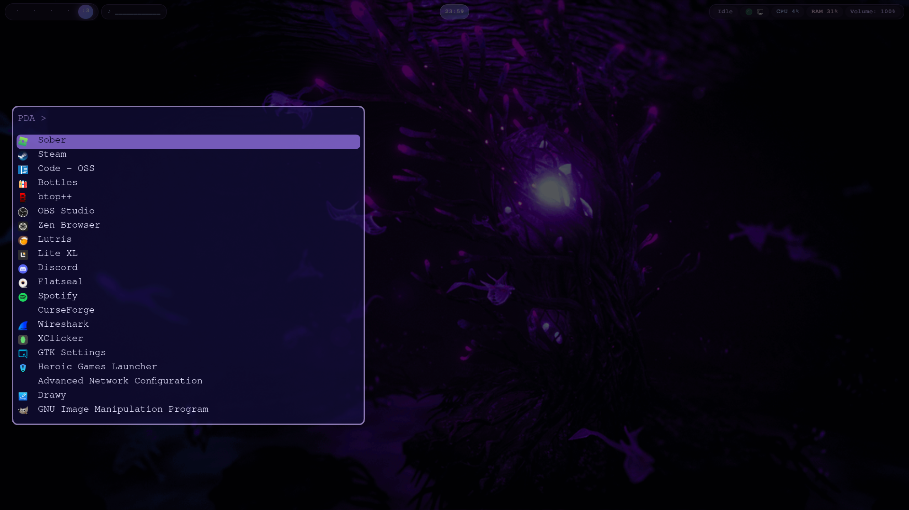

# Alterra PDA — Hyprland × Subnautica Rice

A translucent, frosted-glass **Hyprland** desktop configuration inspired by the **Alterra PDA** interface from *Subnautica*, blended with deep indigo-violet accents.



## Features & Components

| Component | Software | Theme Highlights |
| :--- | :--- | :--- |
| **Window Manager** | `Hyprland` (Lua config) | Dual purple-to-cyan animated borders, frosted glass blur (`vibrancy = 0.5`), custom `pdaSlide` bezier curves |
| **App Launcher** | `Fuzzel` | Left-anchored Alterra PDA drawer (`#151142` indigo glass, `#3ce5ff` PDA cyan prompt, slide-left layer animation) |
| **Notifications** | `Dunst` | Translucent indigo cards with `#cbb2fe` lavender frames & `#3ce5ff` PDA cyan headers |
| **Terminal** | `Kitty` / `Foot` | *Violet Drift (Alterra PDA Edition)* colorscheme (`#131036` at `0.60` opacity + blur) |
| **Shell & Prompt** | `Fish` + `Starship` | Custom prompt matching the indigo/cyan/violet palette |
| **Status Bar** | `Waybar` | Floating translucent pill modules |
| **Lock Screen** | `Hyprlock` | Blurred live desktop backdrop with gradient PDA authentication capsule |
| **Cursor & Icons** | `Catppuccin Mocha Pink` + `Papirus-Dark` | High-contrast dark-mode iconography |

---

## Screenshots



---

## Color Palette

| Role | Hex | Preview |
| :--- | :--- | :--- |
| **Deep Ocean Indigo (Background)** | `#151142` | Translucent HUD glass |
| **Alterra PDA Cyan (Accent)** | `#3CE5FF` | Prompts, clock, progress bars, active highlights |
| **Ion Violet (Selection / Borders)** | `#A882FF` | Active window borders & selection pills |
| **Soft Lavender (Frames)** | `#CBB2FE` | Notification borders & secondary text |
| **Ice White (Foreground)** | `#E6E4FF` | Primary UI & terminal text |

---

## Installation

1. **Install dependencies (Arch Linux):**
   ```bash
   sudo pacman -S hyprland hyprlock hyprpaper waybar fuzzel dunst kitty fish starship papirus-icon-theme
   ```

2. **Clone this repository:**
   ```bash
   git clone https://github.com/MrLauret/Hyprland-Subnautica ~/dotfiles
   cd ~/dotfiles
   ```

3. **Copy or symlink the configs into `~/.config/`:**
   ```bash
   cp -r hypr fuzzel dunst kitty waybar fish foot starship.toml kdeglobals ~/.config/
   ```

4. **Set your wallpaper & GTK theme:**
   * Update the wallpaper path inside `~/.config/hypr/hyprpaper.conf`.
   * *(Note: You will need to apply your preferred dark GTK theme manually via `nwg-look` or `gsettings`.)*

---

## 📄 License

Distributed under the **GPL-3.0 License**. See `LICENSE` for more information.

